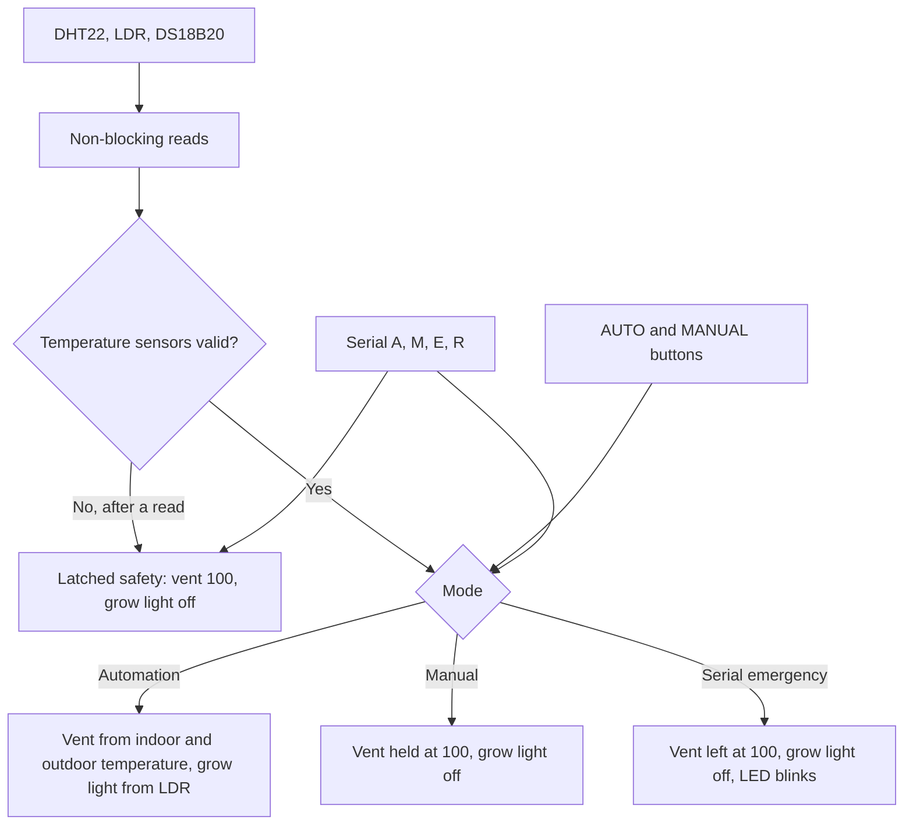

# FloraGuard

FloraGuard is an ESP32 firmware sketch for a small nursery climate controller. It reads indoor and outdoor temperature, humidity, and light, then drives a vent servo, a grow light, a status LED, a buzzer, and an OLED from those readings.

## Overview

The project is a Wokwi simulation. `sketch.ino` is the controller. `diagram.json` is the ESP32 DevKitC V4 circuit. `libraries.txt` is the Wokwi library list. There is no separate application server, database, or web dashboard.

The behaviour below is what the sketch and the wiring diagram implement. This repository does not include a log, photograph, or note from a physical nursery, so it does not show that a built device has been deployed or measured outside the simulator.

## Links

| Resource | Location |
| --- | --- |
| Repository | [github.com/roshelpeter-cpu/floraguard](https://github.com/roshelpeter-cpu/floraguard) |
| Project note | `wokwi-project.txt` points at `https://wokwi.com/projects/476089812993042433` |
| Simulator | [wokwi.com](https://wokwi.com) |

That saved project URL responded with HTTP 404 when this README was written, so the simulation was not opened from the published link. Recreate it from the files in this repository. The steps are under Setup.

## Screenshot gallery

No simulation screenshots are included. The published Wokwi project page did not load, and this environment has no Wokwi CLI that can run `diagram.json` locally. These captures are still needed, taken from the running simulation rather than from a drawing:

| File to add | What it should show |
| --- | --- |
| `docs/screenshots/desktop/circuit.png` | The full breadboard, ESP32, sensors, OLED, servo, LEDs, buzzer, and both buttons |
| `docs/screenshots/desktop/sensors.png` | The ESP32 with the DHT22, LDR, DS18B20, and OLED connected |
| `docs/screenshots/desktop/automation.png` | Automation mode, with the OLED showing indoor, humidity, outdoor, light, and vent |
| `docs/screenshots/desktop/serial.png` | Serial Monitor at 115200 baud, including a status printout |
| `docs/screenshots/desktop/manual.png` | Manual Override, with the OLED reading `MANUAL OVERRIDE` and the vent at 100 |
| `docs/screenshots/desktop/safety.png` | Safety mode after an invalid DHT22 or DS18B20 reading, with the fault screen and the blinking state LED |

Leave those paths empty until the images are captured from Wokwi. Do not substitute a rendered diagram or a stock photograph.

## Problem and purpose

A covered nursery can overheat, dry out, or lose heat if a vent opens fully onto cold outside air. FloraGuard keeps the vent at a measured opening from the indoor temperature, narrows that opening when the outside air is cold, turns a grow light on in low light, and moves to a known-safe vent position if a required temperature sensor fails.

## Operating modes

The sketch starts in `AUTOMATION_MODE`. Three modes share the same entry points for the push buttons and the serial commands.

| Mode | How to enter | Vent | Grow light | State LED | Buzzer |
| --- | --- | --- | --- | --- | --- |
| Automation | Power-up, `A`, or the AUTO button, when safety is not latched | Indoor and outdoor rules below | On below 60% light, off at 60% and above | Off | Pulses if indoor temperature is at least 32 °C or humidity is at least 85% |
| Manual Override | `M` or the MANUAL button, when safety is not latched | Locked at `write(100)` | Forced off | Steady on | Normal climate warning stops |
| Emergency from the serial command `E` | `E` | Moved to 100 and then left there, because automatic ventilation returns immediately while the mode is not automation | Forced off | Blinks every 300 ms | Warning pulses |
| Latched safety | Invalid DHT22 or DS18B20 reading after that sensor has been read | Held at 100 | Forced off | Blinks every 300 ms | Warning pulses |

Safety and Manual Override both force the vent open. Safety has priority: while `safetyMode` is latched, `A` and `M` are refused and the OLED asks for an operator. Serial `E` sets `EMERGENCY_MODE` and the safe vent angle, but it does not latch `safetyMode`. A later `A` can leave that serial emergency. A sensor fault cannot be left with `A` or `M`.

`R` clears a latched fault only when both the DHT22 and the DS18B20 have been read and both readings are currently valid. The mode then returns to automation. If either sensor is still invalid, the reset is refused.

An older comment above `handleSafetyMode()` still says an operator reset is not implemented. The `R` command later in the same file is the reset that is implemented.

## Control rules

### Ventilation

`ventServo.write()` receives the numbers 50, 75, and 100 directly. Those are servo angles in degrees, not a percentage of a 0–180° sweep. The OLED prints them with a percent sign.

In automation, after a valid indoor reading:

| Indoor temperature | Outdoor temperature | Servo angle |
| --- | --- | --- |
| Below 27 °C | Any valid or invalid outdoor reading | 50 |
| 27 °C up to, but not including, 30 °C | Above 15 °C, or outdoor reading invalid | 75 |
| 30 °C or above | Above 15 °C, or outdoor reading invalid | 100 |
| 27 °C up to, but not including, 30 °C | Valid and 15 °C or below | 50 |
| 30 °C or above | Valid and 15 °C or below | 75 |

The last two rows are the hot-inside, cold-outside limit. The OLED then shows `HOT/COLD LIMIT` instead of the normal vent line. Before the first valid DHT22 reading, ventilation does not change the startup angle of 50.

Manual Override and latched safety both write 100 and keep writing it. Serial emergency writes 100 once; later automatic updates do not run until the mode is automation again.

### Grow light

The light level is `analogRead` on the LDR, mapped from 0–4095 to 0–100 and constrained to that range. In automation the grow light is on below 60% and off at 60% or above. The two branches below 30% and from 30% to 59% both turn the LED on. Manual Override, serial emergency, and latched safety force the grow light off.

### Buzzer

Startup is non-blocking: 1000 Hz for 300 ms, 200 ms of silence, then 1500 Hz for 300 ms.

A warning is a 2000 Hz tone for 200 ms, repeated every 1500 ms. It runs for a latched sensor fault, for serial emergency, and in automation when the indoor temperature is at least 32 °C or the humidity is at least 85%, provided the DHT22 reading is valid.

### Sensors and faults

| Sensor | Interval | Accepted range | Fault |
| --- | --- | --- | --- |
| DHT22 indoor temperature and humidity | 2500 ms | Temperature −40 °C to 80 °C, humidity 0% to 100%, neither value NaN | Latched safety after the first attempted read |
| LDR | 250 ms | Mapped ADC 0–4095 | No fault path. The level is always displayed |
| DS18B20 outdoor temperature | Request every 2000 ms, read 800 ms later, without blocking the loop | −55 °C to 125 °C, not `DEVICE_DISCONNECTED_C`, not NaN | Latched safety after the first attempted read |

The OLED refreshes every 500 ms. All of these intervals use `millis()`.

On a latched fault the OLED shows `!! SENSOR FAULT !!`, `FAILED: DHT22` or `FAILED: DS18B20`, `SAFE VENT: 100%`, and `OPERATOR REQUIRED`. If both sensors fail, the screen names the DHT22 because that test is first.

The diagram's starting component values are an indoor DHT22 at 18.8 °C and 61% humidity, and a DS18B20 at 43.5 °C. Both are inside the accepted ranges, so a simulation that keeps those values stays in automation. The indoor temperature is below 27 °C, so the vent rule selects 50. The outdoor temperature is above 15 °C, so the cold-outside limit does not apply. The LDR part has no starting light level in the diagram.

To exercise safety in the simulator, set the DHT22 outside −40 °C to 80 °C or outside 0–100% humidity, or set the DS18B20 outside −55 °C to 125 °C, and wait for that sensor's next read.

## Serial commands

Open the Serial Monitor at **115200** baud. The sketch reads one character at a time.

| Command | Action |
| --- | --- |
| `A` or `a` | Automation, unless safety is latched |
| `M` or `m` | Manual Override, unless safety is latched |
| `E` or `e` | Emergency test. Does not latch `safetyMode` |
| `S` or `s` | Print mode, temperatures, humidity, light, vent angle, and whether the hot/cold limit is active |
| `R` or `r` | Clear latched safety and return to automation when both temperature sensors are currently valid |

The green buttons do the same mode changes. AUTO is the button wired to GPIO32. MANUAL is the button wired to GPIO33. Both use the internal pull-up. A press is a falling edge to ground, debounced for 50 ms. Once a second the sketch prints `BUTTONS | AUTO=` and `MANUAL=` as `1` released or `0` pressed.

## Pin map

The firmware constants and `diagram.json` agree on the signal pins. The board in the diagram is `board-esp32-devkit-c-v4`.

| Function | Firmware pin | Diagram connection |
| --- | --- | --- |
| DHT22 data | GPIO15 | `dht1:SDA` to `esp:15`. VCC and GND on the breadboard rails |
| LDR analog output | GPIO34 | `ldr1:AO` to `esp:34`. VCC and GND on the breadboard rails. GPIO34 is an input-only ADC pin |
| DS18B20 data | GPIO16 | `temp2:DQ` to `esp:16`. VCC and GND on the breadboard rails. No discrete pull-up resistor is drawn |
| OLED SDA | GPIO21 | `oled1:SDA` to `esp:21` |
| OLED SCL | GPIO22 | `oled1:SCL` to `esp:22` |
| OLED address | `0x3C` | `i2cAddress` `0x3c` on the SSD1306 part |
| Vent servo signal | GPIO27 | `servo1:PWM` to `esp:27`. Servo power from `esp:5V`, ground on the breadboard |
| Buzzer | GPIO25 | `bz1:2` to `esp:25`, the other buzzer pin to ground |
| Grow light | GPIO19 | Red LED anode through a 1 kΩ resistor (`r2`) to `esp:19`, cathode to ground |
| State light | GPIO23 | Red LED anode through a 1 kΩ resistor (`r3`) to `esp:23`, cathode to ground |
| AUTO button | GPIO32 | `btn2` to `esp:32` and to ground |
| MANUAL button | GPIO33 | `btn1` to `esp:33` and to ground |

The ESP32 pins are also seated in the breadboard. Those header connections are the `$bb` wires. The coloured wires in the table are the functional links.



## Repository structure

```text
floraguard/
├── sketch.ino           Controller
├── diagram.json         Wokwi circuit
├── libraries.txt        Wokwi library names
└── wokwi-project.txt    Original project URL
```

## Libraries

`libraries.txt` names the libraries Wokwi should install:

- DHT sensor library for ESPx
- Adafruit GFX Library
- Adafruit SSD1306
- OneWire
- DallasTemperature
- ESP32Servo

The sketch includes `DHTesp.h`, `OneWire.h`, `DallasTemperature.h`, `Wire.h`, `Adafruit_GFX.h`, `Adafruit_SSD1306.h`, and `ESP32Servo.h`. `Wire` is part of the ESP32 core.

## Setup in Wokwi

1. Open [Wokwi](https://wokwi.com) and create an ESP32 project. The saved project id in `wokwi-project.txt` was not available when this README was checked.
2. Replace the project diagram with `diagram.json` and the sketch with `sketch.ino`. The diagram already places an ESP32 DevKitC V4, so a separate board menu change is not required once that diagram is loaded.
3. Add the six libraries listed above. Wokwi matches the names in `libraries.txt`.
4. Start the simulation. The serial port in the sketch is 115200 baud.
5. Watch the OLED and the Serial Monitor. At the diagram's starting temperatures the controller should settle in automation with the vent at 50 degrees after the first valid DHT22 sample.
6. Press the GPIO32 button or send `M` for Manual Override. The OLED should say the vent is locked open, and the state LED should stay on.
7. Send `A`, or press the GPIO32 button, to return to automation.
8. Send `S` for the status block.
9. Send `E` to try the emergency path without latching a sensor fault. Send `A` to leave it.
10. To test latched safety, move the DHT22 or DS18B20 attribute outside the accepted range and wait for the next read. The OLED should name the failed sensor. `A` and `M` should be refused. Restore a valid temperature, wait for a good read, then send `R`.

Changing a sensor attribute is a simulator control. It is not evidence from a physical probe.

`readDHT22`, `readLDR`, and `controlVentilation` print on every sample, and `controlGrowLight` prints on every loop while automation is active. The Serial Monitor fills quickly during a normal run. `S` is the single status snapshot.

## What this repository does not show

- A compiled binary or a platform version pin. Build it with the ESP32 Arduino core that provides the board used in the diagram.
- A physical assembly, a calibration record, or a deployment.
- A Wi-Fi, cloud, or phone interface. The only operator channel is the serial port and the two buttons.
- A separate pull-up on the DS18B20 data wire. The diagram connects DQ directly to GPIO16.

## Author

FloraGuard is published by [roshelpeter-cpu](https://github.com/roshelpeter-cpu). `diagram.json` records the diagram author as roshel peter and the editor as Wokwi.
